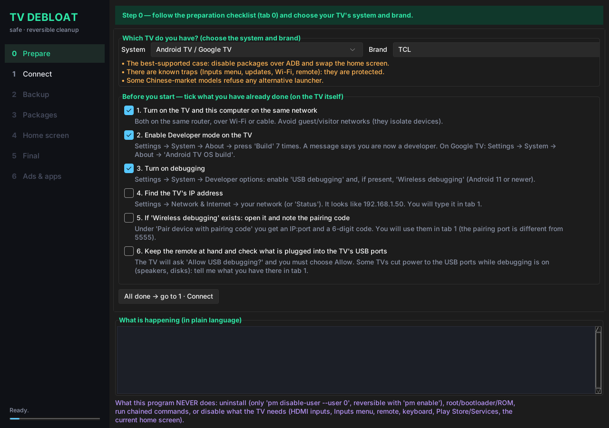
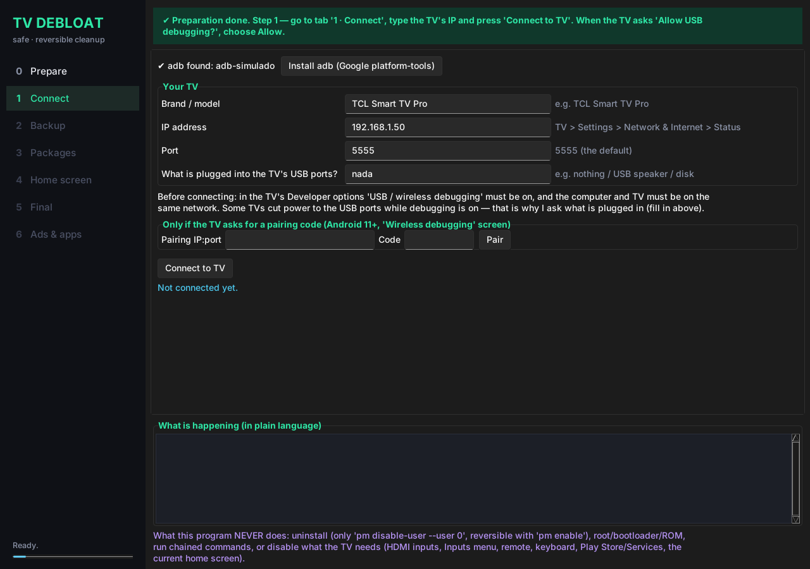
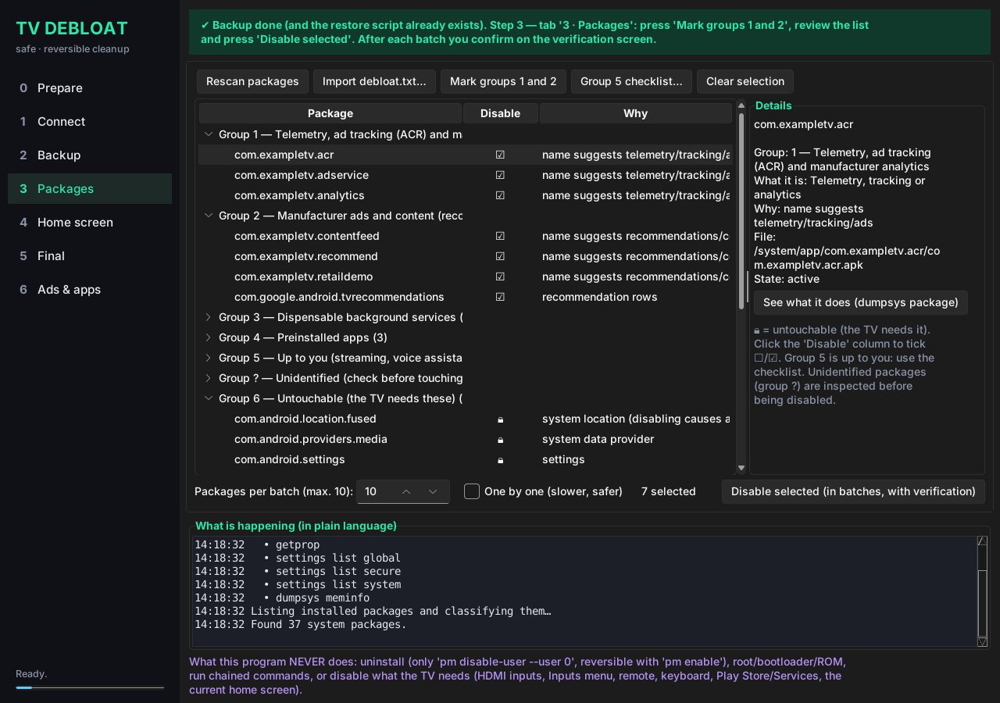
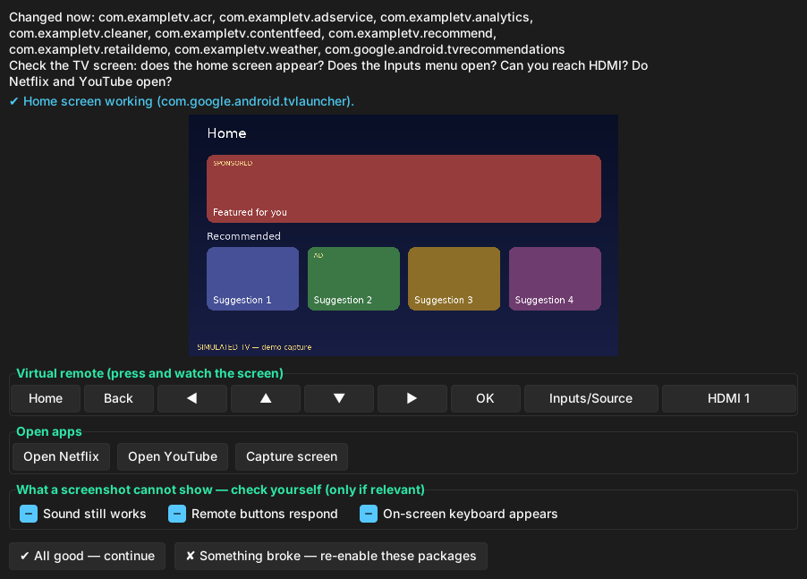
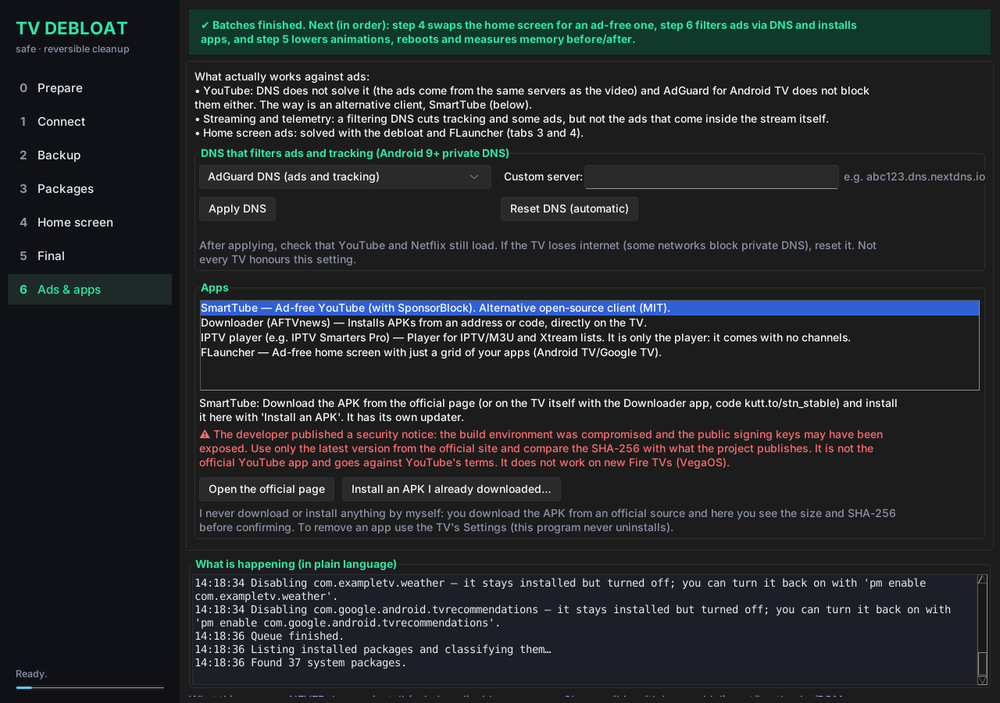
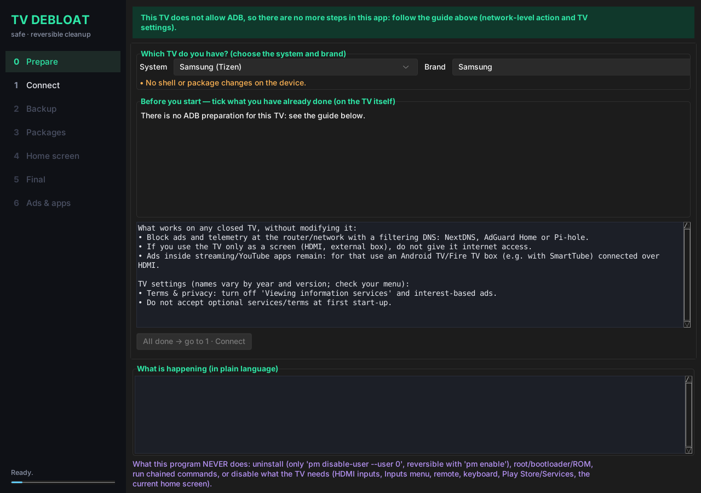

# TV Debloat

A desktop app (Python + Tkinter) that cleans up an Android TV over wireless ADB, **reversibly**:
ads, recommendations, telemetry and apps you never use. Dark UI with a step sidebar and a
"next step" banner that always tells you what to do.

## Screenshots

> Captures of the real interface against a **simulated TV** (`--demo` mode), not a physical TV.
> Regenerate: `DISPLAY=:99 python tools/make_screenshots.py docs/screenshots` (needs Xvfb, ImageMagick and Pillow).

| | |
|---|---|
|  **0 · Prepare** |  **1 · Connect** |
|  **2 · Backup** |  **3 · Packages** |
|  **Verification after every batch** |  **5 · Final** |
|  **6 · Ads & apps** |  **A TV without ADB (Samsung)** |

## Running it

```bash
python main.py          # your TV
python main.py --demo   # simulated TV (pip install pillow)
```

- Python 3.9+ with Tkinter. Linux: `sudo apt install python3-tk` · macOS: `brew install python-tk`.
- Optional modern dark theme: `pip install sv-ttk` (without it the default look is used).
- Custom background: sidebar → "Appearance…" → choose any image, including 4K (needs `pip install pillow`). Sliders for brightness and blur (blur 0 + brightness 1.0 = closest to the original). Remembered in `~/.tv-debloat/config.json`.
- `adb` is looked up on the PATH; if missing, the **Install adb** button downloads Google's official
  platform-tools into the program folder.
- macOS: if `adb` says "No route to host" (Local Network privacy), the program falls back to the
  Python client `adb-shell` (`pip install adb-shell`). Pairing by code only works with the `adb` binary.

## Flow (7 tabs; each unlocks the next)

0. **Prepare** – choose system and brand and tick off what you have done: same Wi-Fi network, Developer mode
   (tap the build number 7 times), USB/wireless debugging, finding the IP. For TVs without ADB it shows a network guide.
1. **Connect** – TV IP, what is in the USB ports, pairing (Android 11+) and approving the dialog on the TV.
2. **Backup** – saves packages, disabled list, `getprop`, global/secure/system settings and `dumpsys meminfo`
   into the `tv-debloat` folder and immediately creates `restore.sh` (or `restore.ps1` on Windows).
3. **Packages** – grouped list (1 telemetry · 2 ads · 3 dispensable services · 4 preinstalled apps ·
   5 your call · ? unidentified · 🔒 untouchable). Batches of up to 10, one `pm` command per call.
   After each batch a screen shows the TV (screenshot) with remote keys, Inputs/HDMI and Netflix/YouTube.
   If something breaks, re-enable the batch and test the packages one by one.
4. **Home screen** – swap to FLauncher, and only then disable the original launcher.
5. **Final** – animations to 0.5, `pm trim-caches 999G`, reboot, before/after measurement, report and **Restore all**.
6. **Ads & apps** – private DNS that filters ads/tracking (reversible) and installing APKs
   (SmartTube, an IPTV player, etc.) that **you** download from official sources.

## Systems and brands

| System | ADB | Home-screen swap | What the program does |
|---|---|---|---|
| Android TV / Google TV (TCL, Sony, Xiaomi, Philips, Hisense, Skyworth, Panasonic…) | yes | yes | everything |
| Amazon Fire TV | yes | no (Fire OS does not allow it) | debloat + apps; Fire OS launcher protected |
| Samsung (Tizen), LG (webOS), Roku, Vidaa/others | no | no | shows a guide only (DNS on the router, TV settings) |

Per-brand warnings come from the open-source projects [cleanyourtv](https://github.com/Gathin23/cleanyourtv) (MIT)
and [dumbtv](https://github.com/humblemuzzu/dumbtv) (MIT), which have per-model tested package lists. You can
import your model's `debloat.txt` in tab 3 (protections still apply).

## Ads: what works and what doesn't

- **YouTube:** DNS does not solve it (the ads come from the same servers as the video). Use SmartTube.
  SmartTube published a security notice about its signing keys: download only from the official site,
  the latest version, and compare the SHA-256.
- **Streaming/telemetry:** filtering DNS cuts tracking and some ads, not those inside the stream.
- **IPTV:** only the player is installed. No lists or channel services are included.

## Rules enforced by the code (not just text)

- `core/guard.py`: command allowlist. `pm uninstall`, chaining (`;`, `&&`, `|`), root, bootloader,
  `setprop`, `rm`… are refused before reaching the TV. Install only accepts files the program itself pushed to
  `/data/local/tmp/tvdebloat-*.apk`; DNS only accepts three modes and a simple hostname.
- `core/packages.py`: untouchable packages (HDMI/antenna, Inputs menu, remote, keyboard, Play Store/Services,
  `location.fused`, TCL traps, the current launcher) can never be ticked. Unidentified packages are
  inspected with `dumpsys package` and blocked if they declare essential services.
- Nothing is disabled without a backup; at most 10 per batch; the original launcher only after
  FLauncher is the default.

## Log

`tv-debloat/` holds `disabled.txt`, `restore.sh|ps1`, `DEBLOAT-LOG.md` (what was done, why and how to undo
each change), `original_settings.txt`, screenshots in `shots/` and the backups.
Undo everything: `sh tv-debloat/restore.sh` (or the **Restore all** button).
If something plugged into the TV's USB ports stops working, turn off USB debugging.

## Tests

```bash
python -m unittest discover -s tests -v
```

They cover the command guard, the protections, restore and the batch flow with a simulated TV.
The Tkinter interface and contact with a real TV are not covered by automated tests; the interface has only been
exercised against the simulated TV.
