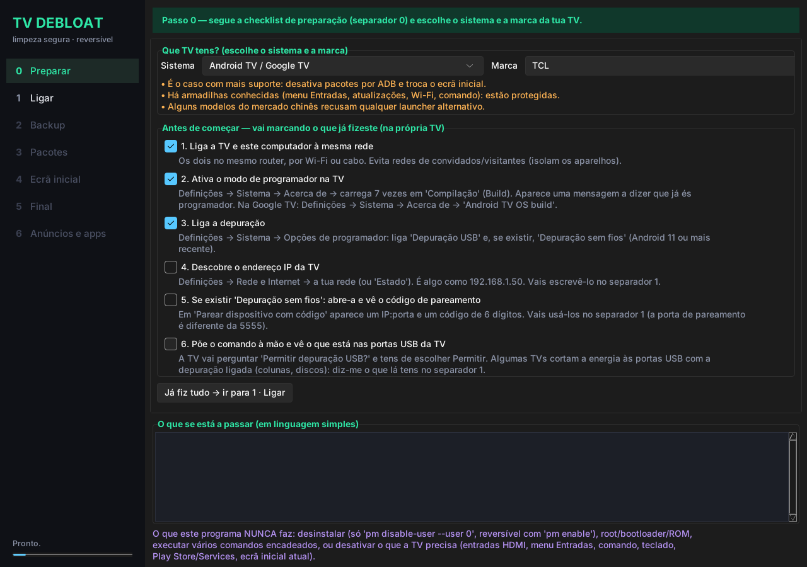
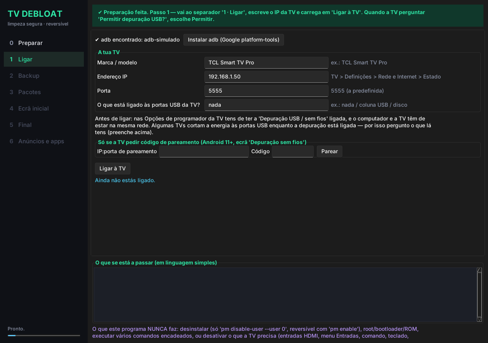
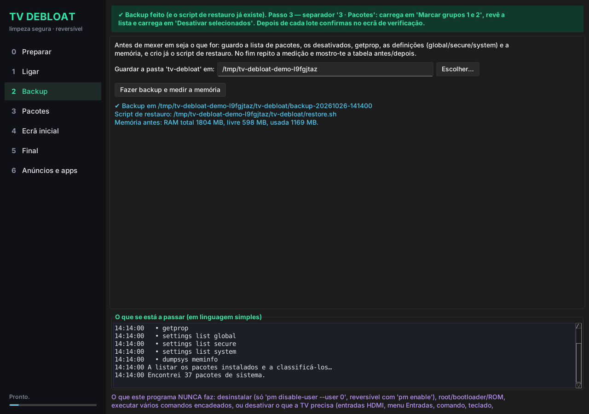
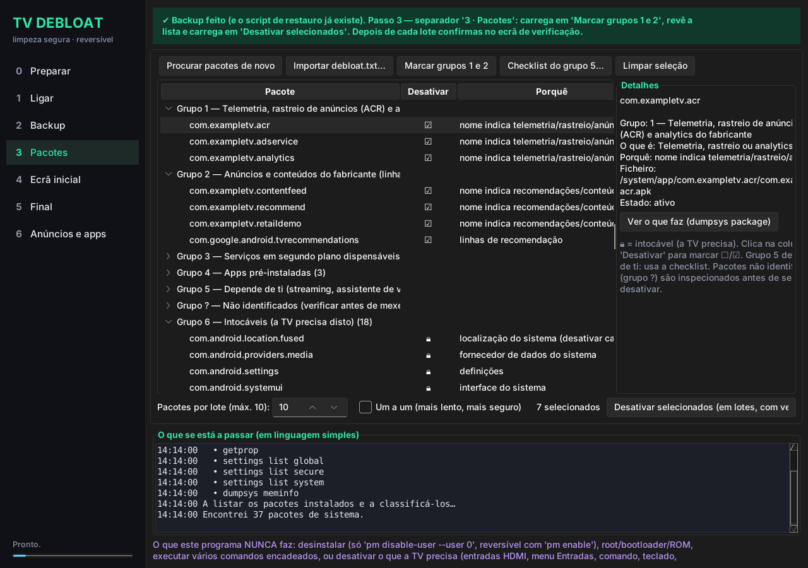
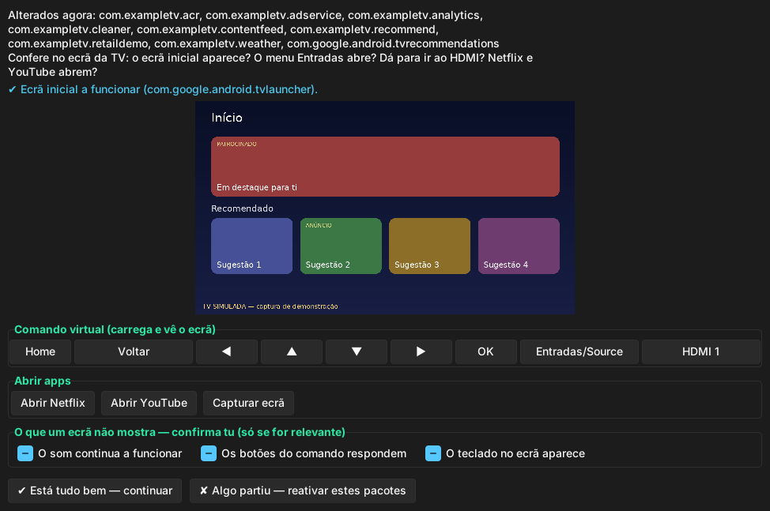
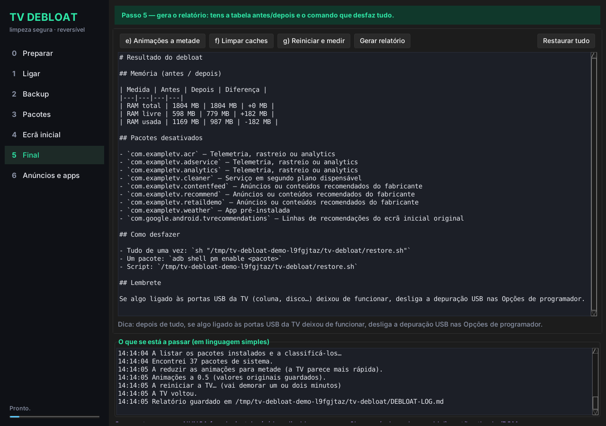
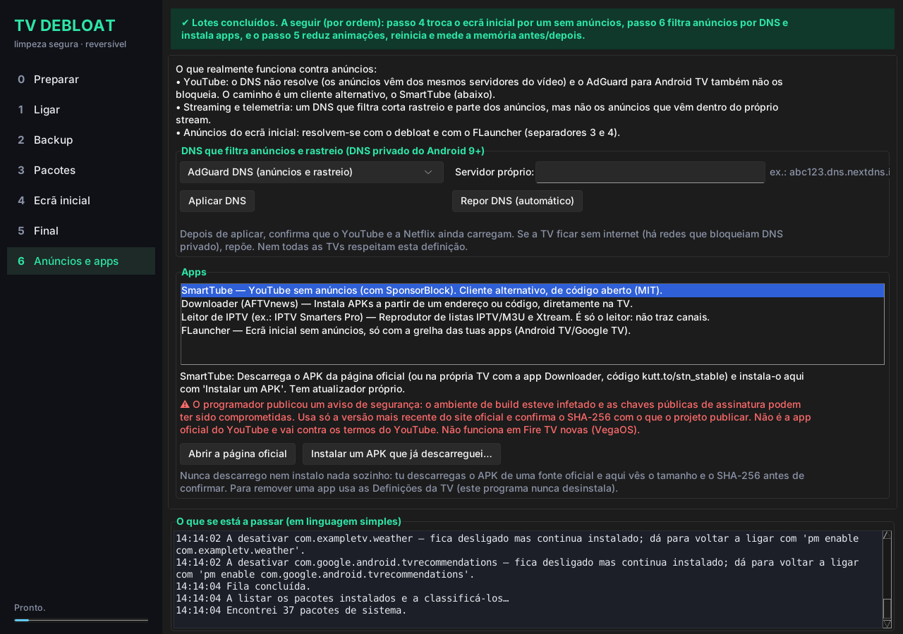
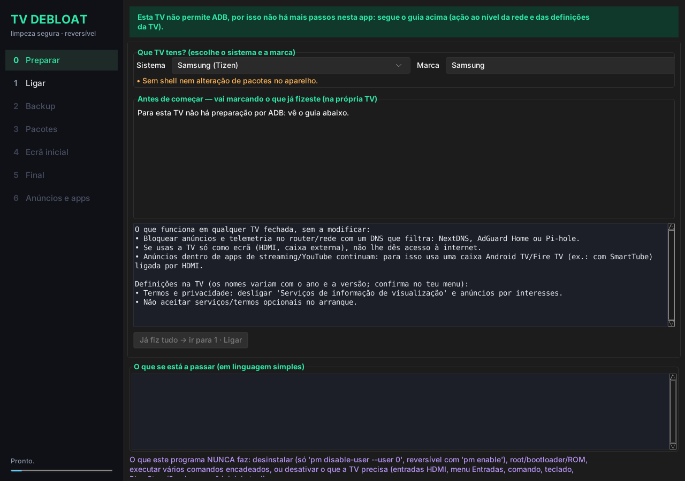

# TV Debloat

Interface de desktop (Python + Tkinter) para limpar uma Android TV por ADB sem fios,
de forma **reversível**: anúncios, recomendações, telemetria e apps que nunca usas.

## Como correr

```bash
python main.py
```

- Python 3.9+ com Tkinter. Para o aspeto escuro moderno: `pip install sv-ttk` (opcional; sem ele fica o aspeto padrão). Linux: `sudo apt install python3-tk` · macOS: `brew install python-tk`.
- O `adb` é procurado no PATH; se não existir, o botão **Instalar adb** descarrega o platform-tools
  oficial da Google para a pasta do programa.
- macOS: se o `adb` der "No route to host" (privacidade de Rede Local), o programa passa sozinho para o
  cliente Python `adb-shell` (`pip install adb-shell`). O pareamento por código só funciona com o `adb`.

Para experimentar sem TV: `pip install pillow` e `python main.py --demo` (TV simulada, não toca em nada real).

## Capturas

> Capturas da interface real contra uma **TV simulada** (modo `--demo`), não de uma TV física.
> Regenerar: `DISPLAY=:99 python tools/make_screenshots.py docs/screenshots` (precisa de Xvfb, ImageMagick e Pillow).

| | |
|---|---|
|  **0 · Preparar** |  **1 · Ligar** |
|  **2 · Backup** |  **3 · Pacotes** |
|  **Verificação após cada lote** |  **5 · Final** |
|  **6 · Anúncios e apps** |  **TV sem ADB (Samsung)** |

## Fluxo (7 separadores; cada um desbloqueia o seguinte, e um aviso verde diz sempre o próximo passo)

0. **Preparar** – escolhes sistema e marca e vais marcando o que já fizeste: mesma rede Wi-Fi, ativar o modo
   de programador (7 toques no número de compilação), depuração USB/sem fios, descobrir o IP. Para TVs sem ADB mostra o guia de rede.
1. **Ligar** – IP da TV, o que está nas portas USB, pareamento (Android 11+) e aprovar o diálogo na TV.
2. **Backup** – guarda pacotes, desativados, `getprop`, definições global/secure/system e `dumpsys meminfo`
   na pasta `tv-debloat`, e cria logo `restore.sh` (ou `restore.ps1` no Windows).
3. **Pacotes** – lista agrupada (1 telemetria · 2 anúncios · 3 serviços dispensáveis · 4 apps pré-instaladas ·
   5 depende de ti · ? não identificados · 🔒 intocáveis). Lotes de até 10, um comando `pm` por chamada.
   Depois de cada lote abre-se um ecrã que mostra a TV (captura), com teclas do comando, Entradas/HDMI e
   Netflix/YouTube. Se algo partir, reativa o lote e testa os pacotes um a um.
4. **Ecrã inicial** – troca para o FLauncher e só depois desativa o launcher original.
5. **Final** – animações a 0.5, `pm trim-caches 999G`, reinício, medição antes/depois, relatório e
   **Restaurar tudo**.
6. **Anúncios e apps** – DNS privado que filtra anúncios/rastreio (reversível) e instalação de APKs
   (SmartTube, leitor de IPTV, etc.) que **tu** descarregas de fontes oficiais.

## Sistemas e marcas

No separador 1 escolhes o sistema e a marca:

| Sistema | ADB | Troca de ecrã inicial | O que o programa faz |
|---|---|---|---|
| Android TV / Google TV (TCL, Sony, Xiaomi, Philips, Hisense, Skyworth, Panasonic…) | sim | sim | tudo |
| Amazon Fire TV | sim | não (o Fire OS não deixa) | debloat + apps; launcher do Fire OS protegido |
| Samsung (Tizen), LG (webOS), Roku, Vidaa/outros | não | não | só mostra um guia (DNS no router, definições da TV) |

Os avisos por marca vêm dos projetos open source [cleanyourtv](https://github.com/Gathin23/cleanyourtv) (MIT)
e [dumbtv](https://github.com/humblemuzzu/dumbtv) (MIT), que têm listas de pacotes testadas por modelo. Podes
importar o `debloat.txt` do teu modelo no separador 3 (continua sujeito às proteções).

## Anúncios: o que funciona e o que não

- **YouTube:** DNS não resolve (anúncios vêm dos mesmos servidores do vídeo). Usa o SmartTube.
  O SmartTube publicou um aviso de segurança sobre as suas chaves de assinatura: descarrega só do site
  oficial, na versão mais recente, e confere o SHA-256.
- **Streaming/telemetria:** o DNS filtrado corta rastreio e parte dos anúncios, não os que vêm dentro do stream.
- **IPTV:** instala-se só o leitor. Não incluo listas nem serviços de canais.

## Regras que o código impõe (não só o texto)

- `core/guard.py`: lista branca de comandos. `pm uninstall`, encadeamentos (`;`, `&&`, `|`), root, bootloader,
  `setprop`, `rm`... são recusados antes de chegar à TV. Instalar só aceita ficheiros que o próprio programa
  enviou para `/data/local/tmp/tvdebloat-*.apk`; o DNS só aceita três modos e um hostname simples.
- `core/packages.py`: pacotes intocáveis (HDMI/antena, menu Entradas, comando, teclado, Play Store/Services,
  `location.fused`, armadilhas TCL, launcher atual) nunca podem ser marcados. Pacotes não identificados são
  inspecionados com `dumpsys package` e bloqueados se declararem serviços essenciais.
- Sem backup feito não se desativa nada; máximo de 10 por lote; o launcher original só depois de o
  FLauncher ser o predefinido.

## Registo

`tv-debloat/` contém `disabled.txt`, `restore.sh|ps1`, `DEBLOAT-LOG.md` (o que foi feito, porquê e como
desfazer cada alteração), `settings_originais.txt`, as capturas em `shots/` e os backups.
Desfazer tudo: `sh tv-debloat/restore.sh` (ou o botão **Restaurar tudo**).
Se algo ligado às portas USB da TV deixar de funcionar, desliga a depuração USB.

## Testes

```bash
python -m unittest discover -s tests -v
```

Cobrem a guarda de comandos, as proteções, o restauro e o fluxo de lotes com uma TV simulada.
A interface Tkinter e o contacto com uma TV real não estão cobertos por testes automáticos.

## Capturas de ecrã

Guarda as capturas em `docs/screenshots/` e descomenta as linhas abaixo:

<!--


-->
